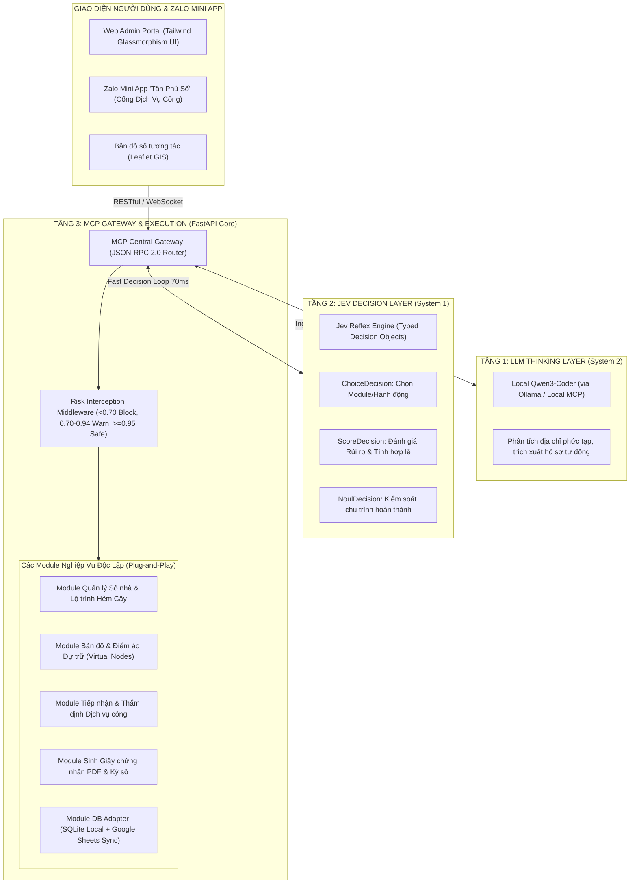

# BẢN THIẾT KẾ KIẾN TRÚC TỔNG THỂ HỆ THỐNG QUẢN LÝ & CẤP SỐ NHÀ
## Đồ án Vibe Coding: 3-Layer Modular Architecture & Glassmorphism GIS

> **Dự án**: Hệ thống Cơ sở dữ liệu Quản lý & Cấp biển số nhà (Tân Phú Số)  
> **Mô hình Vibe Coding**: LLM Thinking (Local Qwen3) ➔ Jev Decision (System 1) ➔ MCP Gateway & Execution (FastAPI + React/HTML5)  
> **Phong cách UI/UX**: Glassmorphism cao cấp, bản đồ số trực quan, Mobile-ready cho Zalo Mini App.

---

## I. TỔNG QUAN KIẾN TRÚC 3 TẦNG ĐỘC LẬP (3-LAYER ARCHITECTURE)

Hệ thống được thiết kế theo đúng nguyên tắc chỉ đạo: **"LLM suy nghĩ, Jev quyết định, Code thực thi"**, tách biệt rõ rệt giữa logic nghiệp vụ, cơ chế phản xạ kiểm soát rủi ro và khả năng suy luận AI.



---

## II. CHI TIẾT TỪNG PHÂN TẦNG CÔNG NGHỆ

### 1. Tầng 1: Thinking Layer (Local Qwen3-Coder)
* **Vai trò**: Đảm nhận các tác vụ suy luận sâu (System 2) khi người dùng hoặc cán bộ nhập dữ liệu phi cấu trúc:
  - Phân tích và chuẩn hóa chuỗi địa chỉ phức tạp từ người dân (ví dụ: *"hẻm sau chùa đối diện số 14..."*).
  - Tóm tắt, đối chiếu tài liệu hồ sơ đất đai, giấy phép xây dựng tải lên.
  - Tư vấn đề xuất cấp số nhà tự động cho cán bộ dựa trên hiện trạng tuyến đường.
* **Cơ chế**: Không can thiệp trực tiếp vào luồng điều khiển; dữ liệu phân tích được chuyển sang Tầng 2 để chuẩn hóa thành `Decision`.

### 2. Tầng 2: Jev Decision Layer (System 1 - Typed Decision)
* **Tốc độ phản xạ**: 70 – 150ms, độ tin cậy tuyệt đối, xuất ra Typed Object:
  - `ChoiceDecision`: Quyết định chọn Module xử lý (ví dụ: `ACTION_INTERPOLATE_VIRTUAL_NODE`, `ACTION_GENERATE_PDF_CERT`, `ACTION_VERIFY_CROSS_SEARCH`).
  - `ScoreDecision`: Chấm điểm rủi ro thuật toán cấp số:
    * Kiểm tra trùng lặp số nhà: nếu trùng ➔ Score < 0.70 (Chặn ngay lập tức).
    * Kiểm tra tính liên tục chẵn/lẻ của tuyến đường: nếu vi phạm quy chuẩn ➔ Cảnh báo (Score 0.75).
    * Hồ sơ hợp lệ, toạ độ khớp tim đường ➔ Score >= 0.95 (Chấp thuận duyệt tự động).
  - `NoulDecision`: Xác nhận hoàn tất quy trình cấp biển số và gửi thông báo ZNS.

### 3. Tầng 3: Backend FastAPI & MCP Gateway
* **Khung ứng dụng**: FastAPI (Python 3.11+ async) với hiệu năng cao, tự sinh Swagger/OpenAPI docs.
* **Single Entry Point**: Toàn bộ thao tác ghi/sửa đều qua Middleware đánh chặn Jev Score.
* **Các Module cốt lõi**:
  1. `app/modules/address_tree`: Thuật toán duyệt cây Path-based routing cho hẻm sâu, ngách nhiều cấp (`Hem_X` ➔ `Ngach_Y` ➔ `SoNha_Z`).
  2. `app/modules/virtual_nodes`: Thuật toán nội suy GPS (Interpolation) tính khoảng cách mặt tiền để tự động dự trữ quỹ số nhà (Virtual Nodes) cho các lô đất trống.
  3. `app/modules/multi_search`: Tra cứu song song 2 chiều Số nhà cũ ⮂ Số nhà mới.
  4. `app/modules/cert_generator`: Tự động điền phôi Giấy chứng nhận biển số nhà PDF chuẩn phôi hành chính, gắn mã QR bảo mật và chữ ký điện tử.
  5. `app/modules/storage`: Cơ chế Hybrid Storage:
     - SQLite nội bộ cho tốc độ truy xuất dưới 5ms, dễ chạy local không phụ thuộc mạng.
     - Google Sheets Sync Adapter (2-way sync) đáp ứng đúng tiêu chuẩn lưu trữ không chi phí máy chủ theo đặc tả `AppCapBienSoNha.md`.
     - Caching in-memory bảo vệ hạn mức Google Sheets API.

---

## III. THIẾT KẾ FRONTEND & PHONG CÁCH GLASSMORPHISM (/UI-UX)

Tuân thủ nghiêm ngặt kỹ năng `/ui-ux` và phong cách **Glassmorphism**:

### 1. Visual Language & Design Tokens
* **Nền tảng gương mờ**: 
  - Thẻ card: `bg-white/70 dark:bg-slate-900/75 backdrop-blur-xl border border-white/20 dark:border-white/10 shadow-xl shadow-slate-900/5`
  - Sidebar & Top Navigation: Thanh công cụ nổi với hiệu ứng kính mờ trong suốt.
* **Bảng màu chủ đạo**:
  - Primary (Hành chính số): `#2563EB` (Blue 600) & `#4F46E5` (Indigo 600).
  - Accent / Hi-tech: `#06B6D4` (Cyan 500) & `#10B981` (Emerald 500).
  - Tương phản & Chữ: `#0F172A` (Slate 900) trên nền sáng, `#F8FAFC` trên dark glass.
* **Typography**: Font hệ thống hiện đại Inter / Be Vietnam Pro, phân cấp thị giác rõ nét.

### 2. Các Màn hình Chức năng Chính
1. **Dashboard & GIS Map Viewport (Màn hình trung tâm)**:
   - Split view: Bản đồ số vệ tinh/vector (Leaflet GIS) hiển thị toàn bộ mạng lưới tuyến đường, tim đường và điểm số nhà (phân biệt màu: Xanh = Hiện hữu, Vàng đứt nét = Điểm ảo dự trữ).
   - Sidebar bên phải: Bảng thông tin chi tiết số nhà, lịch sử số cũ/mới, chủ hộ, toạ độ GPS.
2. **Quản lý Tuyến đường & Cây Hẻm Ngách**:
   - Giao diện trực quan hoá cây phân cấp ngõ ngách, cho phép kéo thả hoặc thêm ngách phụ mà không làm xáo trộn số nhà đã cấp.
3. **Phân hệ Hồ sơ Cấp mới & Đổi số nhà**:
   - Quy trình Kanban / Danh sách hồ sơ dịch vụ công gửi về từ người dân.
   - Trình xem tài liệu đính kèm, ảnh chụp thực địa, nút "Kiểm định AI (Jev Score)" và nút "Duyệt & Xuất PDF".
4. **Cổng Dịch vụ công Dân cư (Zalo Mini App Simulator)**:
   - Giao diện mô phỏng chuẩn màn hình di động Zalo Mini App "Tân Phú Số": Tra cứu nhanh địa chỉ, nộp hồ sơ xin cấp biển số nhà, theo dõi tiến độ.
5. **Bảng Giám sát AI Agent & MCP Gateway**:
   - Xem trực tiếp nhật ký hoạt động của Tầng suy luận (Qwen3) và Tầng phản xạ Jev, biểu đồ điểm rủi ro.

---

## IV. CẤU TRÚC THƯ MỤC DỰ ÁN (PROJECT DIRECTORY LAYOUT)

```
/Users/n3n/Documents/Antigravity 2.0/AppBienSoNha/
├── backend/                        # FastAPI Backend & MCP Gateway
│   ├── app/
│   │   ├── main.py                 # FastAPI Application Entry
│   │   ├── core/                   # Cấu hình, bảo mật, biến môi trường
│   │   │   ├── config.py
│   │   │   └── security.py
│   │   ├── mcp_gateway/            # Cổng MCP Gateway & Middleware
│   │   │   ├── router.py           # Single Entry Point Gateway
│   │   │   ├── middleware.py       # Jev Score Risk Interceptor
│   │   │   └── protocol.py         # JSON-RPC 2.0 Specification
│   │   ├── ai_agents/              # Tầng suy luận & Phản xạ
│   │   │   ├── thinking_llm.py     # Kết nối Local Qwen3 qua Ollama
│   │   │   └── jev_decision.py     # Typed Decision Engine (Choice/Score/Noul)
│   │   ├── modules/                # Các Module nghiệp vụ độc lập
│   │   │   ├── address_tree/       # Path-based routing hẻm ngách
│   │   │   ├── virtual_nodes/      # Nội suy điểm ảo dự trữ
│   │   │   ├── multi_search/       # Tra cứu chéo số cũ - mới
│   │   │   ├── cert_generator/     # Sinh PDF giấy chứng nhận & QR
│   │   │   └── sheets_adapter/     # Đồng bộ Google Sheets / SQLite
│   │   └── models/                 # Schemas & Pydantic models
│   ├── requirements.txt            # Dependencies (fastapi, uvicorn, reportlab, httpx...)
│   └── run.py
│
├── frontend/                       # WebApp & Glassmorphism Dashboard
│   ├── index.html                  # Giao diện chính Responsive
│   ├── css/
│   │   └── glassmorphism.css       # Token & Style Glassmorphism
│   ├── js/
│   │   ├── app.js                  # Khởi tạo App & Quản lý State
│   │   ├── map_gis.js              # Xử lý Bản đồ Leaflet GIS & Lớp số nhà
│   │   ├── address_manager.js      # Giao diện quản lý số nhà & cây hẻm
│   │   ├── applications.js         # Giao diện xử lý hồ sơ cấp mới
│   │   ├── zalo_simulator.js       # Giả lập giao diện Zalo Mini App
│   │   └── ai_monitor.js           # Bảng theo dõi AI Agent & MCP Gateway
│   └── assets/                     # Icons, Logo Tân Phú, phôi chứng nhận mẫu
│
├── AppCapBienSoNha.md              # Đặc tả nghiệp vụ gốc
├── BẢN THIẾT KẾ KIẾN TRÚC TỔNG THỂ DỰ ÁN VIBE CODING.md
└── KIEN_TRUC_HE_THONG_SONHA.md     # Bản thiết kế kiến trúc hệ thống
```

---

## V. KẾ HOẠCH TRIỂN KHAI VIBE CODING (ROADMAP)

* **Giai đoạn 1: Khung kiến trúc Backend & MCP Gateway (Tầng 2 & 3)**
  - Dựng core FastAPI, cổng MCP Gateway và Middleware Jev Score.
  - Xây dựng database schemas (Tuyến đường, Số nhà, Điểm ảo, Hồ sơ cấp mới).
  - Tích hợp kết nối Local Qwen3 thông qua `local-llm` Ollama API.
* **Giai đoạn 2: Cài đặt các thuật toán lõi theo đặc tả**
  - Thuật toán Path-based routing cho cấu trúc cây Hẻm - Ngách.
  - Thuật toán nội suy GPS sinh Virtual Nodes cho đất trống.
  - Công cụ tìm kiếm chéo Multi-Search và API xuất PDF Giấy chứng nhận có QR code.
* **Giai đoạn 3: Xây dựng Giao diện Glassmorphism & Bản đồ số GIS**
  - Dựng layout Dashboard phong cách Glassmorphism với Leaflet map trực quan.
  - Tích hợp các bộ lọc tìm kiếm, bảng danh sách số nhà, modal cấp mới/sửa đổi.
  - Dựng module giả lập Zalo Mini App "Tân Phú Số" cho dịch vụ công.
* **Giai đoạn 4: Kiểm thử, Tinh chỉnh & Cập nhật Cẩm nang**
  - Thử nghiệm các ca biên (hẻm nhiều cấp, số nhà chẵn lẻ đối xứng, trùng số).
  - Cập nhật tài liệu hướng dẫn vào `CAM_NANG_HUONG_DAN.md` theo quy định.
